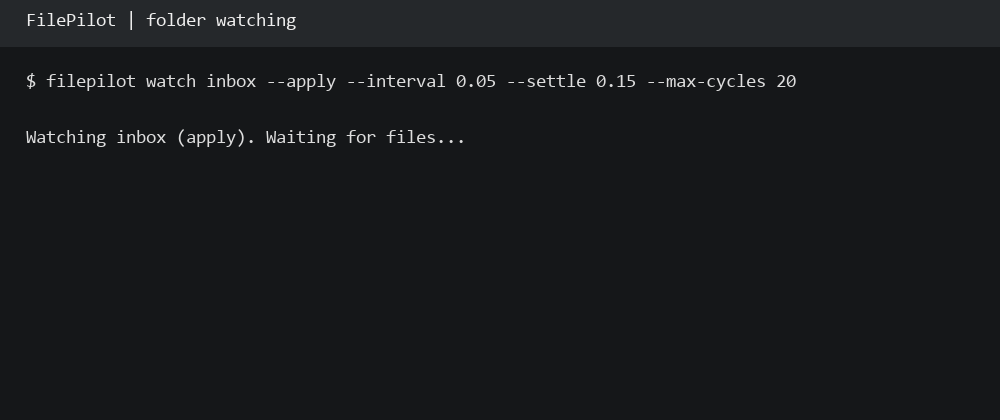

# FilePilot

[](https://github.com/amkumirab/FilePilot/actions/workflows/ci.yml)

FilePilot sorts files into folders using built-in categories or custom TOML rules.
It shows a preview before moving anything and keeps a history for undoing moves.
The `watch` command processes new files after their metadata has stayed unchanged
for a configurable interval.

Requires Python 3.12 or newer. No runtime dependencies.

```text
$ filepilot scan ./inbox
Preview: 3 move(s), 1 skipped
  'invoice.pdf' -> 'Documents/invoice.pdf' ['Documents']
  'photo.png' -> 'Pictures/photo.png' ['Pictures']
  'sales.csv' -> 'Spreadsheets/sales.csv' ['Spreadsheets']
  SKIP 'notes.xyz': no matching rule
No files changed.
```

## What it does

- **Read-only previews.** Both organization and undo require `--apply` to move files.
- **Ordered rules.** Match extensions and optional filename text; the first match wins.
- **Date folders and renaming.** Use the file's modification date in templates.
- **Collision handling.** Existing and planned names get numbered alternatives,
  such as `report (2).pdf`.
- **Journaled runs.** Every attempted move is recorded in `.filepilot/runs/`.
- **Content-aware undo.** Restore original paths after checking SHA-256 hashes.
  Changed files and occupied original paths are left in place with an explanation.
- **Automation-friendly output.** `--json` and documented exit codes.
- **Local operation.** No accounts, API keys, network calls, or telemetry.

## Install from this checkout

Windows PowerShell:

```powershell
py -3.12 -m venv .venv
.\.venv\Scripts\python.exe -m pip install -e .
.\.venv\Scripts\filepilot.exe --help
```

Linux/macOS:

```bash
python3 -m venv .venv
.venv/bin/python -m pip install -e .
.venv/bin/filepilot --help
```

Activate the environment to use the shorter `filepilot` commands below, or use
the executable's full path. `python -m filepilot` works with the installed package
too. The distribution name is `filepilot-organizer`; it has not been published
to PyPI, so install from the checkout or a locally built wheel.

## Quick start

```bash
filepilot scan ./inbox
filepilot organize ./inbox             # preview only
filepilot organize ./inbox --apply     # actually move files
filepilot history ./inbox
filepilot undo ./inbox                 # preview restoration and blocked files
filepilot undo ./inbox --apply         # restore the latest eligible run
```

Choose a particular run with `filepilot undo ./inbox --run RUN_ID --apply`.
Undo can be retried after resolving an occupied original path. Successfully
restored entries are skipped on retry. Empty category folders are kept.

For a self-contained demonstration that only creates temporary sample files
inside this checkout's ignored `.demo/` directory:

```bash
python scripts/demo.py
```

## Watch a folder

```bash
filepilot watch ./inbox                              # continuous preview
filepilot watch ./inbox --apply                      # organize stable files
filepilot watch ./inbox --apply --config rules.toml
filepilot watch ./inbox --interval 1 --settle 5 --json
```

The watcher runs in the foreground. Press **Ctrl+C** to stop it before using undo.
By default it polls once per second and waits for two seconds of unchanged
metadata. Files already in the folder also wait before being processed. A quiet
interval is a heuristic; keep temporary suffixes while writers are still working.

Previews are reported once per unchanged file. Applying watchers record each
batch in history and retry failed moves up to three times per observed version
of a file. Only one applying watcher can run for a folder. Rules are loaded at
startup; restart the watcher after editing them.

`--json` emits JSON Lines events. Use `--max-cycles N` for a bounded run. See
[watching details](docs/watching.md) for events, exit codes, and recovery behavior.



Run the isolated demo with `python scripts/watch_demo.py`. It simulates a download,
checks that each file moves once, stops watching, and verifies undo. Regenerate
the GIF with `python scripts/watch_demo.py --gif docs/watch-demo.gif` after
installing the optional Pillow package. GIF export is not required to run FilePilot.

## Custom rules

```bash
filepilot init --output rules.toml
filepilot scan ./inbox --config rules.toml
filepilot organize ./inbox --config rules.toml --apply
```

`init` refuses to overwrite an existing file. A custom config **replaces** the
built-in rules; unmatched files stay where they are. The config itself is excluded
from scanning when passed through `--config`.

```toml
[[rules]]
name = "Invoices"
extensions = ["pdf"]
contains = "invoice"
target = "Invoices/{year}/{month}"
rename = "{year}-{month}-{day}_{stem}{ext}"

[[rules]]
name = "Other documents"
extensions = ["pdf", "docx", "txt"]
target = "Documents"
```

Both extension and `contains` matching ignore case; when both are supplied,
both must match. Omit `extensions` or use `[]` to match any extension. Omit
`contains` to match any filename. Available template fields:

| Field | Value for `invoice.pdf` modified on 2026-11-08 |
| --- | --- |
| `{name}` | `invoice.pdf` |
| `{stem}` | `invoice` |
| `{ext}` | `.pdf` (includes the dot) |
| `{year}` / `{month}` / `{day}` | `2026` / `11` / `08` |

Dates use local time and modification time, not creation time or photo EXIF data.
Targets must be relative subdirectories using `/`. Rename templates must produce
a single filename. If `rename` is provided, include `{ext}` to keep the extension.
Unknown fields, path traversal, reserved Windows names, symbolic links, junctions,
and conflicting planned file/directory paths are rejected.

Built-in categories: Documents, Spreadsheets, Pictures, Videos, Audio, Archives.
Only immediate regular files are scanned; subdirectories, dotfiles, Windows hidden
files, links, and common incomplete-download suffixes are skipped.

## Scripting

```bash
filepilot scan ./inbox --json
filepilot organize ./inbox --apply --json
filepilot history ./inbox --json
filepilot undo ./inbox --json
```

Exit codes: `0` success or preview, `1` a run with failed/blocked entries,
`2` an input or filesystem error, `130` interruption. Read-only undo previews
return `0` even when some moves are blocked; inspect their per-file `status`.
Filesystem/input error messages go to stderr even with `--json`.

## Safety and limits

Use a quiet folder. The lock coordinates FilePilot instances, not other apps
editing files or changing paths. Previews are regenerated by `organize --apply`,
so rescan after changing rules or folder contents. Undo checks content, not file
identity or metadata. It restores file paths, not previous edits.

Keep `.filepilot/` intact and do not relocate the organized root before undoing.
Interrupted runs can be inspected with `history` and recovered with `undo`.
Ambiguous states are left untouched for manual inspection. Journals use durable
file writes and atomic replacement, but there is no cross-filesystem transaction
or guarantee against power loss. Important files still need a separate backup.

On Windows, moves use non-replacing rename. On POSIX, moves use exclusive hard
links followed by unlink, so source and destination must share a filesystem that
supports hard links. Unsupported filesystems produce per-file errors; no copy
fallback is attempted. See [architecture and recovery](docs/architecture.md).

## Development

```bash
python -m pip install -e . -r requirements-dev.txt
python -m ruff check .
python -m ruff format --check .
python -m unittest discover -s tests -v
python -m coverage run -m unittest discover -s tests -v
python -m coverage combine
python -m coverage report
python -m build
```

Tests use real isolated files and subprocesses, including interrupted operations,
collisions, Unicode names, tampered journals, directory links, and process locks.
Filesystem scenarios are grouped into focused suites:

- `tests/test_organization.py`: rules, destination collisions, and file content.
- `tests/test_recovery.py`: undo, interrupted runs, and recoverable failures.
- `tests/test_native_filesystem.py`: native file handles, POSIX moves, and process locks.
- `tests/test_input_validation.py`: invalid configuration and journal data.

Run one suite with, for example:

```bash
python -m unittest discover -s tests -p test_recovery.py -v
```

The included CI workflow targets Windows and Ubuntu with Python 3.12 and 3.13.
Results are available in [GitHub Actions](https://github.com/amkumirab/FilePilot/actions).
See [the QA report](docs/qa-report.md) for measured coverage, tested failure
scenarios, and the limits of verification.

## Roadmap

- Scheduled runs and reports.
- Desktop interface for reviewing plans and editing rules.

## License

[MIT](LICENSE).
